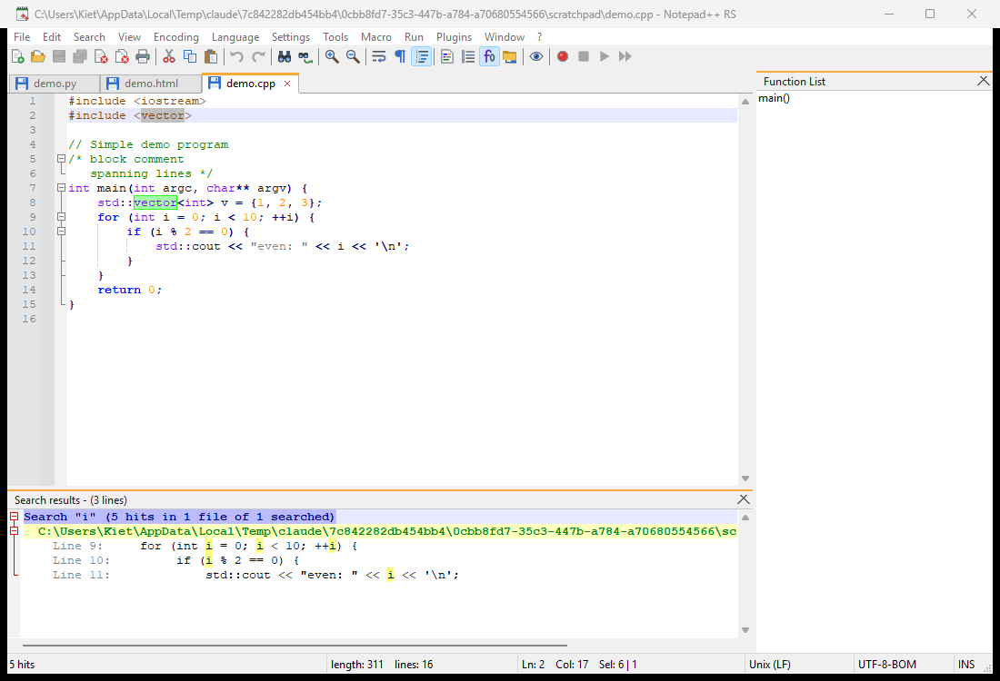

# Notepad++ RS

A native Windows text editor modeled closely on **Notepad++**, written from scratch in Rust.

Unlike egui/cross-platform clones, Notepad++ RS is a real Win32 application: native menu bar, native toolbar
with tooltips, native status bar and native dialogs, plus a custom-drawn Scintilla-style editor control
implemented in pure Rust (GDI rendering, no Scintilla, no C++).

> Not affiliated with Notepad++ (created by Don Ho). All code and icon artwork here are original.



## Build & run

```bash
cargo build --release
```

```bash
target\release\notepad-rs.exe [files...]
```

Requires the Rust MSVC toolchain on Windows 10/11. The binary is a single self-contained ~3 MB exe.

## What it does (Notepad++ parity)

| Area | Features |
|------|----------|
| Look & feel | Notepad++ menu tree (File, Edit, Search, View, Encoding, Language with A–Z submenus, Settings, Tools, Macro, Run, Plugins, Window, ?), toolbar in Notepad++ order, tab bar with orange active indicator and blue/red save-state floppies, 6-part status bar (type, length/lines, Ln/Col/Pos/Sel, EOL, encoding, INS/OVR), per-monitor DPI aware |
| Editor | Line numbers, bookmark margin, change-history markers (orange = modified, green = saved), box-tree fold margin with active-fold highlight, indent guides, current-line highlight, brace matching, smart highlighting (double-click a word), show whitespace / EOL (CRLF boxes) / control chars (NUL boxes), word wrap, zoom, edge column |
| Editing | Multi-caret (Ctrl+click), column/rectangular selection (Alt+drag, Alt+Shift+arrows) with column paste, auto-indent + smart brace indent, undo/redo with typing coalescing, overtype, word completion popup, auto-close brackets (optional) |
| Line ops | Duplicate, delete, move up/down, transpose, join, split, sort (lex/case-insensitive/numeric/length), reverse, remove duplicates/empty lines, insert blank above/below, trim, TAB↔space, EOL→space |
| Comments / case | Toggle/line/block comment per language, UPPER/lower/Proper/Sentence/iNVERT/random case |
| Search | Tabbed Find / Replace / Find in Files / Mark dialog (Normal, Extended `\n \t \x..`, Regex with `$1`/`\1`), match case, whole word, wrap, backward, in selection, transparency; Find All → dockable *Search results* panel with hit highlighting, folding and F4/Shift+F4 navigation; Mark All with bookmarks; 5 token styles; Go To line/offset; go to / select matching brace |
| Bookmarks | Toggle/next/prev/clear, cut/copy/remove (non-)bookmarked lines, inverse |
| Languages | 38 languages with Notepad++ default colors: C, C++, C#, Java, JavaScript, TypeScript, JSON, Go, Rust, Swift, Kotlin, Objective-C, PHP, Perl, Ruby, Python, Lua, SQL, Batch, PowerShell, Shell, Makefile, CMake, INI, Properties, TOML, XML, HTML (embedded JS/CSS), CSS, Markdown, YAML, Diff, VB, Pascal, Assembly, Haskell, R, TeX |
| Folding | Brace, tag (XML/HTML), indentation (Python/YAML), section (INI/TOML); fold all/current/level 1–8 |
| Panels | Function List (classes ◆ and functions for ~25 languages, click to jump), Search results |
| Files | UTF-8, UTF-8-BOM, UTF-16 LE/BE, ANSI; "Encode in" (reinterpret) vs "Convert to"; CRLF/LF/CR; reload, rename, save copy, recycle bin, recent files, restore closed tab (Ctrl+Shift+T), drag & drop, external-change detection, Monitoring (tail -f), print |
| Known limits | Mixed line endings in one file are normalized to the dominant style on save; no split/dual view, Document Map or plugin system yet |
| Session | Notepad++-style session snapshot: open tabs, carets, bookmarks and **unsaved/untitled text** survive restarts (periodic backup every 7 s), single instance (second launch forwards files) |
| Macro | Record / stop / playback / run N times or until EOF, Trim Trailing Space and Save |
| Other | Column editor (Alt+C: text or number sequences dec/hex/oct/bin), Run… with `$(FULL_CURRENT_PATH)` etc., MD5 / SHA-256, Base64 / URL encode-decode, ASCII↔HEX, Style Configurator (themes: Default, Obsidian, Monokai, Solarized-light; font/size), Preferences, Summary, Windows… list, Shortcut Mapper, always-on-top, full screen (F11), post-it (F12) |

Command line: `notepad-rs [-n<line>] [-c<col>] [-l<Language>] [-ro] [-nosession] [-multiInst] files...`

Settings and session live in `%APPDATA%\notepad-rs\`.

## Architecture

| Module | Role |
|--------|------|
| `doc.rs` | Document: `ropey` rope, multi-selections, rectangular selection, grouped undo/redo, bookmarks, change history |
| `ops.rs` | Editing operations (typing, paste, line ops, comments, case, indentation, column insert) + unit tests |
| `highlight.rs` | Incremental per-line lexers (state + fold level cache with convergence) and fold-range computation |
| `lang.rs`, `theme.rs` | Language specs/keywords and color themes (values from Notepad++'s `stylers.model.xml`) |
| `editor.rs` | The custom editor control: layout (wrap + folds), GDI double-buffered painting, mouse/keyboard, IME |
| `tabbar.rs` | Custom-drawn Notepad++-style tab bar |
| `find.rs` | Search engine and the tabbed Find dialog |
| `funclist.rs` | Function List outline parser |
| `dialogs.rs` | Native dialogs built from in-memory `DLGTEMPLATEEX` (Go To, Column Editor, Preferences, …) |
| `app.rs`, `menu.rs` | Main window, layout, commands, sessions/backups, menus and accelerators |
| `icons.rs` | Tiny anti-aliased vector rasterizer that draws all toolbar/tab/app icons at any DPI |

```bash
cargo test
```
